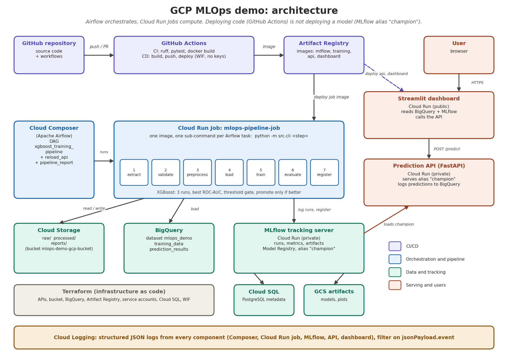

# GCP MLOps demo: Airflow + MLflow + XGBoost + Cloud Run

An end-to-end MLOps proof of concept on Google Cloud. The ML model (XGBoost on the UCI *Bank
Marketing* dataset) is only a vehicle: the goal is to **orchestrate, track, deploy, monitor
and reproduce** an ML workflow.



Design decisions worth knowing:

* **Airflow orchestrates, it does not compute.** Each DAG task triggers the same Cloud Run Job
  with a different sub-command (`python -m src.cli <step>`), so Composer needs no ML dependencies.
* **Deploying code is not deploying a model.** GitHub Actions deploys application code. A new model
  goes live when the pipeline registers a better version and moves the MLflow alias
  `champion`; the DAG then calls `POST /reload` on the API.
* **Promotion guard.** The best of 3 runs (by ROC-AUC) must reach `MIN_ROC_AUC` (default 0.75)
  **and** beat the current champion to be promoted.
* **MLflow and the API are private Cloud Run services.** Callers send Google ID tokens
  (`src/utils/auth.py`); the proper service accounts get `roles/run.invoker`.
* **No long-lived keys.** GitHub Actions authenticates with Workload Identity Federation.
* **Dashboard access is role-based.** Visitors sign in with Google (Streamlit's built-in OIDC login, Step 10b). Normal users only see the *Predictions* form; admins also see the full dashboard and a *Pipeline admin* tab (run the Cloud Run Job, control the Airflow DAG). Roles come from e-mail allow-lists, and every admin function re-checks the role in Python.

```
.
├── airflow/dags/xgboost_pipeline.py   # DAG xgboost_training_pipeline
├── src/                               # pipeline code (data, features, models, utils) + CLI
├── training/Dockerfile                # image of the Cloud Run Job
├── mlflow_server/                     # MLflow tracking server image (Cloud SQL + GCS)
├── api/                               # FastAPI prediction service
├── dashboard/                         # Streamlit app
├── infrastructure/terraform/          # APIs, GCS, BigQuery, AR, SAs/IAM, Cloud SQL, WIF
├── tests/  scripts/  .github/workflows/{ci,cd}.yml
```

---

## How to read this guide

All commands are for **Windows PowerShell**.

**Every value lives in one place: the file `env.ps1` created in Step 2.** All later commands use
variables (`$PROJECT_ID`, `$REGION`, `$BUCKET`, ...), so a typo can only happen once, in that file.

| Variable | Meaning | Value |
|---|---|---|
| `$PROJECT_ID` | GCP project ID | `mlops-demo-gcp` |
| `$REGION` | GCP region | `europe-west1` |
| `$GITHUB_REPO` | GitHub repository (`OWNER/REPO`) | `8-chems/gcp-mlops-demo` |
| `$BILLING` | Your billing account ID | the only value you must fill in yourself |
| `$MY_EMAIL` | Your Google account | detected automatically |
| `$BUCKET` | Data bucket created by Terraform | `mlops-demo-gcp-bucket` |
| `$REGISTRY` | Artifact Registry path | `europe-west1-docker.pkg.dev/mlops-demo-gcp/mlops` |
| `$SQL_CONN` | Cloud SQL connection name | `mlops-demo-gcp:europe-west1:mlflow-pg` |

Rules of thumb:

* Run every command from the **project root** (the folder containing `requirements.txt`) unless a step says otherwise.
* **New PowerShell window? Run `. .\env.ps1` first** (dot, space, dot-backslash). Variables vanish when a window closes. If a command fails with `expected one argument` or an empty value, this is almost always the reason. The helper `Check-Env` (defined in `env.ps1`) tells you which variables are missing.
* A backtick `` ` `` at the very end of a line continues the command. **Nothing, not even a space, may follow it.**
* In PowerShell, `curl` is an alias of another command: this guide uses `curl.exe`.
* Docker Desktop must be **running** for Step 6.

---

## 0. Prerequisites

| Tool | Check |
|---|---|
| A Google account with billing enabled | |
| Google Cloud CLI (`gcloud`, includes `bq`) | `gcloud --version` |
| Terraform ≥ 1.5 | `terraform -version` |
| Docker Desktop (WSL 2 backend) | `docker --version` |
| **Python 3.11** (3.13 is *not* supported by the pinned versions) | `py -3.11 --version` |
| Git | `git --version` |
| GitHub CLI | `gh --version` |

Install with winget. The `--source winget` option avoids the Microsoft Store source, which can fail with a certificate error:

```powershell
winget install --id Python.Python.3.11 --source winget
winget install --id Google.CloudSDK --source winget
winget install --id Hashicorp.Terraform --source winget
winget install --id Docker.DockerDesktop --source winget
winget install --id Git.Git --source winget
winget install --id GitHub.cli --source winget
```

Close and reopen PowerShell afterwards. Python 3.13 can stay installed: the `py` launcher lets you choose 3.11 per project (`py -0` lists both).

**Cost warning.** Cloud Composer (about $10+/day) and Cloud SQL (about $10/month) bill while they exist, even idle. Cloud Run scales to zero. Do Steps 1-10 first, create Composer only in Step 11, and run **Step 15 (cleanup)** when done. Set a budget alert in *Billing → Budgets & alerts*.

**Certificate errors?** If `pip`, `gcloud`, `terraform`, `git` or `docker build` fail with `unable to get local issuer certificate` / `CERTIFICATE_VERIFY_FAILED`, your antivirus or network is re-signing HTTPS traffic. See the first row of the Troubleshooting table before continuing.

---

## 1. Run everything locally first (free)

```powershell
py -3.11 -m venv .venv
.venv\Scripts\Activate.ps1
python --version          # must print 3.11.x
python -m pip install --upgrade pip
pip install -r requirements-dev.txt
```

If PowerShell refuses to run `Activate.ps1`, run `Set-ExecutionPolicy -Scope CurrentUser RemoteSigned` once and retry.

Make ruff treat `airflow` as an external library (otherwise it reports an import-order error because the project has an `airflow/` folder), then lint and test:

```powershell
Add-Content pyproject.toml "`n[tool.ruff.lint.isort]`nknown-third-party = [`"airflow`"]"
ruff check . --fix
ruff check .
pytest -q
```

`ruff check .` should print `All checks passed!` and `pytest -q` should report `13 passed`.

Optional: run the whole ML flow locally (clean, split, train 3 XGBoost runs, evaluate, register) on a throw-away SQLite MLflow:

```powershell
python scripts\download_data.py
$env:MIN_ROC_AUC = "0.5"
python scripts\local_smoke_test.py
```

The smoke test ends with `OK`. To browse the 3 runs, go **into the folder it created** and use a relative path (absolute SQLite paths are easy to get wrong on Windows):

```powershell
$SMOKE = Get-ChildItem $env:TEMP -Directory -Filter "mlops-smoke-*" | Sort-Object LastWriteTime -Descending | Select-Object -First 1
cd $SMOKE.FullName
mlflow ui --backend-store-uri sqlite:///mlflow.db
```

Open http://localhost:5000, stop with Ctrl+C, then come back with `cd` to your project folder. Without `data\bank-additional-full.csv` the smoke test uses synthetic data.

Fix a line-ending trap now: shell scripts must use Unix line endings or the MLflow container will not start.

```powershell
Set-Content .gitattributes "*.sh text eol=lf" -Encoding ascii
(Get-Content mlflow_server\entrypoint.sh -Raw) -replace "`r`n","`n" | Set-Content -NoNewline mlflow_server\entrypoint.sh
```

---

## 2. Create `env.ps1` (all variables in one file)

First look up your billing account ID:

```powershell
gcloud billing accounts list
```

Create the file. **Replace `XXXXXX-XXXXXX-XXXXXX` by your billing account ID** (the only value to edit), then run the block:

```powershell
@'
# ---- edit only $BILLING ----
$BILLING      = "XXXXXX-XXXXXX-XXXXXX"

# ---- project settings ----
$PROJECT_ID   = "mlops-demo-gcp"
$REGION       = "europe-west1"
$GITHUB_REPO  = "8-chems/gcp-mlops-demo"

# ---- derived names (do not edit) ----
$MY_EMAIL     = gcloud config get-value account 2>$null
$BUCKET       = "$PROJECT_ID-bucket"
$REGISTRY     = "$REGION-docker.pkg.dev/$PROJECT_ID/mlops"
$SQL_CONN     = "${PROJECT_ID}:${REGION}:mlflow-pg"
$JOB          = "mlops-pipeline-job"
$COMPOSER_ENV = "mlops-demo"
$SA_MLFLOW    = "sa-mlflow@$PROJECT_ID.iam.gserviceaccount.com"
$SA_TRAINING  = "sa-training@$PROJECT_ID.iam.gserviceaccount.com"
$SA_API       = "sa-api@$PROJECT_ID.iam.gserviceaccount.com"
$SA_DASHBOARD = "sa-dashboard@$PROJECT_ID.iam.gserviceaccount.com"
$SA_AIRFLOW   = "sa-airflow@$PROJECT_ID.iam.gserviceaccount.com"
$CICD_SA      = "sa-cicd@$PROJECT_ID.iam.gserviceaccount.com"

function Check-Env([string[]]$Names) {
  $missing = $Names | Where-Object { -not (Get-Variable $_ -ValueOnly -ErrorAction SilentlyContinue) }
  if ($missing) { Write-Host "MISSING: $($missing -join ', ')  -> run: . .\env.ps1" -ForegroundColor Red }
  else { Write-Host "OK: all variables set" -ForegroundColor Green }
}
'@ | Set-Content env.ps1 -Encoding ascii

Add-Content .gitignore "env.ps1"
Add-Content .gitignore "payload.json"

. .\env.ps1
Check-Env PROJECT_ID,REGION,GITHUB_REPO,BILLING,MY_EMAIL,BUCKET,REGISTRY,SQL_CONN
$PROJECT_ID; $REGION; $GITHUB_REPO; $MY_EMAIL; $BUCKET; $REGISTRY; $SQL_CONN
```

`$MY_EMAIL` is only filled after `gcloud auth login` (Step 3); if it is empty now, run `. .\env.ps1` again after logging in.
Later steps append `WIF_PROVIDER`, `MLFLOW_URL` and `API_URL` to this same file.

## 3. Create the GCP project and link billing

```powershell
. .\env.ps1
gcloud auth login
gcloud auth application-default login
. .\env.ps1                      # refresh $MY_EMAIL now that you are logged in
gcloud projects create $PROJECT_ID
gcloud config set project $PROJECT_ID
gcloud billing projects link $PROJECT_ID --billing-account=$BILLING
gcloud auth application-default set-quota-project $PROJECT_ID
gcloud projects list
```

* If `projects create` says the project already exists (and it is yours), continue.
* If the ID is taken globally, change `$PROJECT_ID` once in `env.ps1` and run `. .\env.ps1`: every other name derives from it.
* If linking fails with a quota error, your billing account has too many linked projects. See *Troubleshooting → billing quota*.

## 4. Provision the infrastructure with Terraform

Creates: required APIs, GCS bucket, BigQuery dataset `mlops_demo` (+ `prediction_results`), Artifact Registry repo `mlops`, 6 service accounts with least-privilege IAM, Cloud SQL PostgreSQL for MLflow, the DB password in Secret Manager, and Workload Identity Federation for GitHub.

`terraform.tfvars` is generated from your variables, so it always matches `env.ps1`:

```powershell
. .\env.ps1
cd infrastructure\terraform
@"
project_id  = "$PROJECT_ID"
region      = "$REGION"
github_repo = "$GITHUB_REPO"
"@ | Set-Content terraform.tfvars -Encoding ascii
Get-Content terraform.tfvars

# The Terraform code names the bucket "<project_id>-mlops-demo". Rename it to "<project_id>-bucket":
(Get-Content main.tf -Raw).Replace('${var.project_id}-mlops-demo','${var.project_id}-bucket') | Set-Content main.tf -NoNewline -Encoding ascii
Select-String -Path main.tf -Pattern "bucket_name ="

terraform init
terraform apply
```

`Select-String` must show `bucket_name = "${var.project_id}-bucket"`.

> **Already ran `terraform apply` before this change?** Terraform will replace the old (empty) bucket `mlops-demo-gcp-mlops-demo` with `mlops-demo-gcp-bucket`. If you had already uploaded the dataset (Step 5), upload it again after the apply.

Type `yes` when asked (about 8-12 minutes; Cloud SQL is the slow part). If it fails with *API not enabled*, wait one minute and run `terraform apply` again.

> **Already ran `terraform apply` with a different repository name?** The GitHub repository allowed to deploy is stored in Google Cloud. Fix `$GITHUB_REPO` in `env.ps1`, rerun the block above and `terraform apply` again: it updates this setting in place (no resources are recreated).

Read the outputs and go back to the project root:

```powershell
$WIF_PROVIDER = terraform output -raw wif_provider
terraform output -raw bucket
terraform output -raw cloudsql_connection_name
cd ..\..
Add-Content env.ps1 "`$WIF_PROVIDER = '$WIF_PROVIDER'"
$WIF_PROVIDER
```

The bucket printed by Terraform must equal `$BUCKET`, and the connection name must equal `$SQL_CONN`. `$WIF_PROVIDER` must look like `projects/123456789/locations/global/workloadIdentityPools/github-pool/providers/github-provider`.

## 5. Upload the dataset to Cloud Storage

```powershell
. .\env.ps1
python scripts\download_data.py
gcloud storage cp data\bank-additional-full.csv "gs://$BUCKET/raw/bank-additional-full.csv"
gcloud storage ls "gs://$BUCKET/raw/"
```

(Skip the first line if `data\bank-additional-full.csv` already exists.) The pipeline samples `SAMPLE_ROWS=15000` of the ~41k rows (fixed seed 42).

## 6. Build and push the Docker images

Start **Docker Desktop** and wait until it reports that the engine is running. Check with `docker info` (it must print server information, not an error).

```powershell
. .\env.ps1
Check-Env REGISTRY,REGION
gcloud auth configure-docker "$REGION-docker.pkg.dev" --quiet

docker build --platform linux/amd64 -t "$REGISTRY/mlflow:latest" mlflow_server
docker build --platform linux/amd64 -t "$REGISTRY/training:latest" -f training/Dockerfile .
docker build --platform linux/amd64 -t "$REGISTRY/api:latest" -f api/Dockerfile .
docker build --platform linux/amd64 -t "$REGISTRY/dashboard:latest" -f dashboard/Dockerfile .

foreach ($i in "mlflow","training","api","dashboard") {
  docker push "$REGISTRY/${i}:latest"
}

gcloud artifacts docker images list $REGISTRY
```

The last command must list the four images.

## 7. Deploy the MLflow tracking server (Cloud Run + Cloud SQL + GCS)

```powershell
. .\env.ps1
Check-Env PROJECT_ID,REGION,REGISTRY,BUCKET,SQL_CONN,SA_MLFLOW

$MLFLOW_ENV = "DB_USER=mlflow,DB_NAME=mlflow,CLOUDSQL_CONNECTION_NAME=${SQL_CONN},ARTIFACT_ROOT=gs://${BUCKET}/mlflow-artifacts"

gcloud run deploy mlflow --region $REGION --image "$REGISTRY/mlflow:latest" `
  --service-account $SA_MLFLOW `
  --no-allow-unauthenticated `
  --add-cloudsql-instances $SQL_CONN `
  --set-env-vars $MLFLOW_ENV `
  --set-secrets "DB_PASSWORD=mlflow-db-password:latest" `
  --memory 1Gi --cpu 1 --min-instances 0 --max-instances 2
```

Then read the service URL (only after the deploy succeeded) and save it:

```powershell
$MLFLOW_URL = gcloud run services describe mlflow --region $REGION --format "value(status.url)"
Add-Content env.ps1 "`$MLFLOW_URL = '$MLFLOW_URL'"
$MLFLOW_URL
```

The service is private. Give your account permission, then use the authenticated proxy and open http://localhost:5000 (Ctrl+C to stop):

```powershell
gcloud run services add-iam-policy-binding mlflow --region $REGION --member "user:$MY_EMAIL" --role roles/run.invoker
gcloud run services proxy mlflow --region $REGION --port 5000
```

## 8. Create the pipeline Cloud Run Job and wire permissions

```powershell
. .\env.ps1
Check-Env PROJECT_ID,REGION,REGISTRY,BUCKET,MLFLOW_URL,SA_TRAINING,JOB

$JOB_ENV = "GCP_PROJECT_ID=${PROJECT_ID},GCP_REGION=${REGION},GCS_BUCKET=${BUCKET},BQ_DATASET=mlops_demo,MLFLOW_TRACKING_URI=${MLFLOW_URL},MIN_ROC_AUC=0.75,SAMPLE_ROWS=15000"

gcloud run jobs create $JOB --region $REGION `
  --image "$REGISTRY/training:latest" `
  --service-account $SA_TRAINING `
  --set-env-vars $JOB_ENV `
  --memory 2Gi --cpu 1 --max-retries 0 --task-timeout 1800
```

Allow the service accounts to call the private MLflow service:

```powershell
foreach ($sa in $SA_TRAINING,$SA_API,$SA_DASHBOARD) {
  gcloud run services add-iam-policy-binding mlflow --region $REGION `
    --member "serviceAccount:$sa" --role roles/run.invoker
}
```

## 9. Milestone 1: run the pipeline by hand (no Airflow yet)

Each step runs as a Cloud Run Job execution; this validates GCS, BigQuery, MLflow and permissions.

```powershell
. .\env.ps1
$RUN_ID = "manual1"
foreach ($s in "extract","validate","preprocess","load","train","evaluate","register") {
  Write-Host "=== $s ==="
  gcloud run jobs execute $JOB --region $REGION "--args=${s},--run-id,${RUN_ID}" --wait
  if ($LASTEXITCODE -ne 0) { Write-Host "Step $s failed, stopping." -ForegroundColor Red; break }
}
```

Expected result: `processed/clean.csv` in the bucket, table `mlops_demo.training_data` in BigQuery, 3 runs in the MLflow experiment `bank-marketing-xgboost`, and model `bank-marketing-xgb` version 1 with alias `champion`. Verify:

```powershell
bq query --use_legacy_sql=false "SELECT split, COUNT(*) AS n, AVG(target) AS rate FROM mlops_demo.training_data GROUP BY split"
```

If a step fails, read the job logs (Step 13): the failing step logs `pipeline_failure` with the error. A failing `evaluate` (`ThresholdNotMet`) is a *feature*: the model is below `MIN_ROC_AUC` and is not registered.

## 10. Milestone 2: deploy the API and the dashboard

```powershell
. .\env.ps1
Check-Env PROJECT_ID,REGION,REGISTRY,MLFLOW_URL,SA_API,SA_DASHBOARD,SA_AIRFLOW

$API_ENV = "GCP_PROJECT_ID=${PROJECT_ID},GCP_REGION=${REGION},MLFLOW_TRACKING_URI=${MLFLOW_URL},LOG_PREDICTIONS_TO_BQ=true"

gcloud run deploy api --region $REGION --image "$REGISTRY/api:latest" `
  --service-account $SA_API `
  --no-allow-unauthenticated --min-instances 0 --memory 1Gi `
  --set-env-vars $API_ENV

$API_URL = gcloud run services describe api --region $REGION --format "value(status.url)"
Add-Content env.ps1 "`$API_URL = '$API_URL'"
$API_URL
```

The dashboard, Airflow and you must be allowed to call the private API:

```powershell
foreach ($sa in $SA_DASHBOARD,$SA_AIRFLOW) {
  gcloud run services add-iam-policy-binding api --region $REGION `
    --member "serviceAccount:$sa" --role roles/run.invoker
}
gcloud run services add-iam-policy-binding api --region $REGION --member "user:$MY_EMAIL" --role roles/run.invoker
```

Deploy the dashboard:

```powershell
$DASH_ENV = "GCP_PROJECT_ID=${PROJECT_ID},GCP_REGION=${REGION},MLFLOW_TRACKING_URI=${MLFLOW_URL},API_URL=${API_URL}"

gcloud run deploy dashboard --region $REGION --image "$REGISTRY/dashboard:latest" `
  --service-account $SA_DASHBOARD `
  --allow-unauthenticated --min-instances 0 --memory 1Gi `
  --set-env-vars $DASH_ENV `
  --update-secrets /app/.streamlit/secrets.toml=dashboard-auth-secrets:latest

gcloud run services describe dashboard --region $REGION --format "value(status.url)"
```

> **Note.** The `--update-secrets` flag mounts the Secret Manager secret directly as `/app/.streamlit/secrets.toml` inside the container (no custom entrypoint needed). The secret must exist before the first deploy — create it in Step 10b §3.

Test the API. First get an identity token, tell the API to load the champion model, and check its health:

```powershell
$TOKEN = gcloud auth print-identity-token
curl.exe -s -X POST "$API_URL/reload" -H "Authorization: Bearer $TOKEN" -d "{}"
curl.exe -s "$API_URL/health" -H "Authorization: Bearer $TOKEN"
```

Create the request file and send a prediction:

```powershell
@'
{
  "age": 40, "job": "admin.", "marital": "married", "education": "high.school",
  "default": "no", "housing": "yes", "loan": "no", "contact": "cellular", "month": "may",
  "day_of_week": "mon", "campaign": 2, "pdays": 999, "previous": 0, "poutcome": "nonexistent",
  "emp_var_rate": 1.1, "cons_price_idx": 93.9, "cons_conf_idx": -36.4, "euribor3m": 4.8,
  "nr_employed": 5191
}
'@ | Set-Content payload.json -Encoding ascii

curl.exe -s -X POST "$API_URL/predict" -H "Authorization: Bearer $TOKEN" -H "Content-Type: application/json" --data "@payload.json"
```

The token lasts about an hour; rerun `$TOKEN = gcloud auth print-identity-token` to refresh it.

> **Security note.** At this stage the dashboard is open to anyone with the URL. **Step 10b** adds Google sign-in and roles; do it before sharing the link. The API and MLflow stay private.

Open the dashboard URL: *Data overview* (BigQuery), *Model experiments* (MLflow), *Model performance* (champion artifacts) and *Predictions* (calls the API).

(Step 10b below replaces this basic dashboard with the version that has Google sign-in and roles.)

## 10b. Google sign-in and roles (users and admins)

| Who | Gets |
|---|---|
| Not signed in | A "Sign in with Google" page |
| Signed in but not allowed | "Access restricted" |
| **User** | The *Predictions* form only. Each submission is stored in BigQuery with their e-mail (`submitted_by`). |
| **Admin** | All tabs plus *Pipeline admin*: run a Cloud Run Job step, trigger / pause / unpause the Airflow DAG |

Roles: e-mails in `ADMIN_EMAILS` are admins. If `ALLOWED_EMAILS` is empty, any verified Google account is a normal user; otherwise only the listed e-mails are. Hiding tabs is not the security: each admin function checks the role again in Python (`require_admin()`).

### 1. Add the `submitted_by` column in BigQuery (Terraform)

```powershell
. .\env.ps1
cd infrastructure\terraform
$old = '{ name = "features", type = "STRING", mode = "NULLABLE" },'
$new = $old + "`n    " + '{ name = "submitted_by", type = "STRING", mode = "NULLABLE" },'
(Get-Content main.tf -Raw).Replace($old, $new) | Set-Content main.tf -NoNewline -Encoding ascii
Select-String -Path main.tf -Pattern "submitted_by"
terraform apply
cd ..\..
```

`Select-String` must show one line. The apply updates the table in place (adding a nullable column).

### 2. Create the Google OAuth client (Google Cloud console)

1. *APIs & Services → OAuth consent screen*: choose **External**, fill the app name and your support e-mail.
2. Set the publishing status to **In production**. While it is "Testing", only listed test users can sign in. The default scopes (`openid`, `email`, `profile`) are the ones Streamlit requests.
3. *APIs & Services → Credentials → Create credentials → OAuth client ID → Web application*.
4. Under **Authorized redirect URIs** add the output of this command, exactly:

```powershell
$DASH_URL = gcloud run services describe dashboard --region $REGION --format "value(status.url)"
"$DASH_URL/oauth2callback"
```

5. Copy the **client ID** and **client secret**.

### 3. Store the sign-in settings in Secret Manager

Use the helper script — it generates a random cookie secret, writes a temp file, uploads it to Secret Manager, deletes the local file, and grants the SA access in one go:

```powershell
. .\env.ps1
$DASH_URL = gcloud run services describe dashboard --region $REGION --format "value(status.url)"

.\scripts\setup_auth_secret.ps1 `
    -GoogleClientId     "PASTE_CLIENT_ID" `
    -GoogleClientSecret "PASTE_CLIENT_SECRET" `
    -DashUrl            $DASH_URL `
    -SaDashboard        $SA_DASHBOARD
```

The script creates (or updates) the `dashboard-auth-secrets` secret with the correct structure:

```toml
[auth]
redirect_uri  = "https://<dash-url>/oauth2callback"
cookie_secret = "<random-32-byte-base64>"

[auth.default]
client_id           = "<your-client-id>"
client_secret       = "<your-client-secret>"
server_metadata_url = "https://accounts.google.com/.well-known/openid-configuration"
```

> **Important.** The section must be `[auth.default]` (not `[auth.google]`). `st.login()` called without arguments looks for the `default` provider. A flat `[auth]`-only structure or `[auth.google]` causes a 500 / missing-keys error.

The `secrets.toml` file is never written inside the repo and is deleted immediately after upload. To rotate credentials later, just re-run the script — it adds a new secret version automatically.

### 4. Update the code

**Dependencies and Docker command** (Streamlit's login needs Authlib; the admin tab needs the Cloud Run client; Streamlit enables CORS/XSRF protection by itself once auth is configured, so remove the two flags):

```powershell
@'
streamlit>=1.42.0
Authlib>=1.3.2
google-cloud-run>=0.10.0
pandas==2.2.3
numpy==1.26.4
pyarrow==18.1.0
db-dtypes>=1.3.0
mlflow-skinny==2.22.0
google-cloud-bigquery>=3.25.0
google-auth>=2.30.0
requests>=2.32.0
'@ | Set-Content dashboard\requirements.txt -Encoding ascii

(Get-Content dashboard\Dockerfile -Raw).Replace(' --server.enableCORS=false --server.enableXsrfProtection=false', '') | Set-Content dashboard\Dockerfile -NoNewline -Encoding ascii
New-Item dashboard\__init__.py -ItemType File -Force | Out-Null
```

**API:** replace `api\main.py` by the new `main.py` (it reads the `X-Submitted-By` header and stores it in `submitted_by`).

**Dashboard files.** Create or replace these three files (click to expand):

<details>
<summary><code>dashboard\auth.py</code> (new)</summary>

```python
"""Google sign-in (Streamlit OIDC) and role resolution (user / admin)."""
import os

import streamlit as st


def _emails(var: str) -> set[str]:
    return {e.strip().lower() for e in os.getenv(var, "").split(",") if e.strip()}


def require_login() -> str:
    """Show the sign-in page until the visitor is signed in; return their verified e-mail."""
    if not st.user.is_logged_in:
        st.title("MLOps demo - Bank Marketing")
        st.write("Sign in with your Google account to continue.")
        st.button("Sign in with Google", on_click=st.login)
        st.stop()
    email = (getattr(st.user, "email", "") or "").lower()
    if not email or not getattr(st.user, "email_verified", False):
        st.error("Your Google e-mail is missing or not verified.")
        st.button("Sign out", on_click=st.logout)
        st.stop()
    return email


def role_of(email: str) -> str | None:
    """'admin' if listed in ADMIN_EMAILS; 'user' if allowed; None if not allowed.

    ALLOWED_EMAILS empty means: any verified Google account is a normal user."""
    if email in _emails("ADMIN_EMAILS"):
        return "admin"
    allowed = _emails("ALLOWED_EMAILS")
    return "user" if not allowed or email in allowed else None


def require_admin() -> str:
    """Call this INSIDE every admin function, not only when drawing the UI."""
    email = (getattr(st.user, "email", "") or "").lower()
    if not st.user.is_logged_in or role_of(email) != "admin":
        raise PermissionError("Admin only")
    return email
```

</details>

<details>
<summary><code>dashboard\admin.py</code> (new)</summary>

```python
"""Admin actions: run the Cloud Run Job and control the Airflow DAG (admins only)."""
import os
from datetime import datetime, timezone

import google.auth
from google.auth.transport.requests import AuthorizedSession
from google.cloud import run_v2

from dashboard.auth import require_admin
from src.config import get_settings
from src.utils.logging import log_event

DAG_ID = "xgboost_training_pipeline"


def run_job_step(step: str, run_id: str) -> str:
    """Start one execution of the pipeline job for a single step; returns the operation name."""
    admin = require_admin()
    s = get_settings()
    job = os.getenv("PIPELINE_JOB_NAME", "mlops-pipeline-job")
    name = f"projects/{s.project_id}/locations/{s.region}/jobs/{job}"
    override = run_v2.RunJobRequest.Overrides.ContainerOverride(args=[step, "--run-id", run_id])
    request = run_v2.RunJobRequest(
        name=name, overrides=run_v2.RunJobRequest.Overrides(container_overrides=[override])
    )
    operation = run_v2.JobsClient().run_job(request=request)
    log_event("admin_job_triggered", component="dashboard", user=admin, step=step, run_id=run_id)
    return operation.operation.name


def _airflow():
    base = os.getenv("AIRFLOW_URL", "").rstrip("/")
    if not base:
        raise RuntimeError("AIRFLOW_URL is not configured (create Composer first, see Step 11).")
    creds, _ = google.auth.default(scopes=["https://www.googleapis.com/auth/cloud-platform"])
    return AuthorizedSession(creds), base, os.getenv("AIRFLOW_API", "v1")


def trigger_dag() -> dict:
    admin = require_admin()
    session, base, version = _airflow()
    body: dict = {"conf": {}}
    if version == "v2":  # Airflow 3 requires a logical date
        body["logical_date"] = datetime.now(timezone.utc).isoformat()
    response = session.post(f"{base}/api/{version}/dags/{DAG_ID}/dagRuns", json=body, timeout=90)
    response.raise_for_status()
    log_event("admin_dag_triggered", component="dashboard", user=admin)
    return response.json()


def set_dag_paused(paused: bool) -> None:
    admin = require_admin()
    session, base, version = _airflow()
    response = session.patch(
        f"{base}/api/{version}/dags/{DAG_ID}",
        params={"update_mask": "is_paused"},
        json={"is_paused": paused},
        timeout=90,
    )
    response.raise_for_status()
    log_event("admin_dag_paused", component="dashboard", user=admin, paused=paused)
```

</details>

<details>
<summary><code>dashboard\app.py</code> (replaces the existing file)</summary>

```python
"""Streamlit dashboard: Google sign-in, role-based tabs (user / admin)."""
import os
import tempfile

import pandas as pd
import requests
import streamlit as st
from mlflow.tracking import MlflowClient

from dashboard.auth import require_login, role_of
from src.config import get_settings
from src.features.preprocessing import FEATURES, TARGET
from src.utils.auth import auth_headers, configure_mlflow_auth
from src.utils.logging import log_event

st.set_page_config(page_title="MLOps demo - Bank Marketing", layout="wide")
S = get_settings()
API_URL = os.getenv("API_URL", "http://localhost:8080").rstrip("/")
AIRFLOW_URL = os.getenv("AIRFLOW_URL", "").rstrip("/")

# ---- sign-in and role --------------------------------------------------------------------
email = require_login()
role = role_of(email)
if role is None:
    st.error("Access restricted. Ask an admin to add your e-mail.")
    st.button("Sign out", on_click=st.logout)
    st.stop()
st.sidebar.write(f"Signed in as **{email}** ({role})")
st.sidebar.button("Sign out", on_click=st.logout)

CHOICES = {
    "job": ["admin.", "blue-collar", "entrepreneur", "housemaid", "management", "retired",
            "self-employed", "services", "student", "technician", "unemployed", "unknown"],
    "marital": ["married", "single", "divorced", "unknown"],
    "education": ["basic.4y", "basic.6y", "basic.9y", "high.school", "illiterate",
                  "professional.course", "university.degree", "unknown"],
    "default": ["no", "yes", "unknown"], "housing": ["no", "yes", "unknown"],
    "loan": ["no", "yes", "unknown"], "contact": ["cellular", "telephone"],
    "month": ["jan", "feb", "mar", "apr", "may", "jun", "jul", "aug", "sep", "oct", "nov", "dec"],
    "day_of_week": ["mon", "tue", "wed", "thu", "fri"],
    "poutcome": ["nonexistent", "failure", "success"],
}


@st.cache_data(ttl=600)
def load_training_data() -> pd.DataFrame:
    from src.utils.bigquery import read_table

    return read_table(S.training_table_id, S.project_id)


def mlflow_client() -> MlflowClient:
    configure_mlflow_auth()
    return MlflowClient(tracking_uri=S.mlflow_tracking_uri)


@st.cache_data(ttl=120)
def load_runs() -> pd.DataFrame:
    client = mlflow_client()
    exp = client.get_experiment_by_name(S.experiment_name)
    if exp is None:
        return pd.DataFrame()
    runs = client.search_runs([exp.experiment_id], order_by=["attributes.start_time DESC"],
                              max_results=100)
    return pd.DataFrame([{
        "run": r.info.run_name, "run_id": r.info.run_id[:8],
        "pipeline_run_id": r.data.tags.get("pipeline_run_id"),
        **{k: r.data.params.get(k) for k in ("max_depth", "learning_rate", "n_estimators")},
        **{k: round(v, 4) for k, v in r.data.metrics.items()},
    } for r in runs])


st.title("MLOps demo - Bank Marketing (XGBoost)")
names = ["Predictions"] if role == "user" else [
    "Data overview", "Model experiments", "Model performance", "Predictions", "Pipeline admin"]
T = dict(zip(names, st.tabs(names), strict=True))

if "Data overview" in T:
    with T["Data overview"]:
        try:
            df = load_training_data()
            c1, c2, c3, c4 = st.columns(4)
            c1.metric("Rows", f"{len(df):,}")
            c2.metric("Features", len(FEATURES))
            c3.metric("Missing values", int(df.isna().sum().sum()))
            c4.metric("Positive rate", f"{df[TARGET].mean():.1%}")
            st.subheader("Target distribution")
            st.bar_chart(df[TARGET].value_counts().rename({0: "no", 1: "yes"}))
            st.subheader("Data quality")
            st.write(f"Duplicate rows: {int(df.drop(columns=['split']).duplicated().sum())}")
            st.write(df["split"].value_counts().rename("rows per split"))
            st.dataframe(df.head(50))
        except Exception as exc:  # noqa: BLE001
            log_event("dashboard_error", severity="ERROR", component="dashboard", tab="data",
                      error=repr(exc))
            st.error(f"Could not load BigQuery data: {exc}")

if "Model experiments" in T:
    with T["Model experiments"]:
        try:
            runs = load_runs()
            if runs.empty:
                st.info("No MLflow runs yet. Execute the pipeline first.")
            else:
                st.dataframe(runs, use_container_width=True)
                st.bar_chart(runs.set_index("run")[["roc_auc", "f1", "accuracy"]])
        except Exception as exc:  # noqa: BLE001
            log_event("dashboard_error", severity="ERROR", component="dashboard",
                      tab="experiments", error=repr(exc))
            st.error(f"Could not reach MLflow: {exc}")

if "Model performance" in T:
    with T["Model performance"]:
        try:
            client = mlflow_client()
            mv = client.get_model_version_by_alias(S.model_name, S.model_alias)
            run = client.get_run(mv.run_id)
            st.write(f"Champion: **{S.model_name} v{mv.version}** (run `{mv.run_id[:8]}`)")
            metric_names = ["accuracy", "precision", "recall", "f1", "roc_auc"]
            for col, m in zip(st.columns(5), metric_names, strict=True):
                col.metric(m, f"{run.data.metrics.get(m, float('nan')):.3f}")
            with tempfile.TemporaryDirectory() as tmp:
                images = ["confusion_matrix", "roc_curve", "feature_importance"]
                for col, name in zip(st.columns(3), images, strict=True):
                    path = client.download_artifacts(mv.run_id, f"evaluation/{name}.png", tmp)
                    col.image(path, caption=name.replace("_", " "))
        except Exception as exc:  # noqa: BLE001
            log_event("dashboard_error", severity="ERROR", component="dashboard",
                      tab="performance", error=repr(exc))
            st.warning(f"No champion model available yet: {exc}")

with T["Predictions"]:
    st.write("Will this customer subscribe to a term deposit?")
    with st.form("predict"):
        c1, c2, c3 = st.columns(3)
        payload = {}
        for i, (name, opts) in enumerate(CHOICES.items()):
            payload[name] = [c1, c2, c3][i % 3].selectbox(name, opts)
        payload["age"] = c1.number_input("age", 16, 110, 40)
        payload["campaign"] = c2.number_input("campaign", 1, 60, 2)
        payload["pdays"] = c3.number_input("pdays (999 = never)", 0, 999, 999)
        payload["previous"] = c1.number_input("previous", 0, 20, 0)
        payload["emp_var_rate"] = c2.number_input("emp_var_rate", -4.0, 2.0, 1.1)
        payload["cons_price_idx"] = c3.number_input("cons_price_idx", 90.0, 96.0, 93.9)
        payload["cons_conf_idx"] = c1.number_input("cons_conf_idx", -55.0, -25.0, -36.4)
        payload["euribor3m"] = c2.number_input("euribor3m", 0.5, 5.5, 4.8)
        payload["nr_employed"] = c3.number_input("nr_employed", 4900.0, 5300.0, 5191.0)
        submitted = st.form_submit_button("Predict")
    if submitted:
        try:
            r = requests.post(
                f"{API_URL}/predict", json=payload,
                headers={**auth_headers(API_URL), "X-Submitted-By": email}, timeout=60)
            r.raise_for_status()
            out = r.json()
            label = "WILL subscribe" if out["prediction"] else "will NOT subscribe"
            st.success(f"Prediction: customer {label} (probability {out['probability']:.1%}, "
                       f"model v{out['model_version']}). Your submission was recorded.")
        except Exception as exc:  # noqa: BLE001
            log_event("api_connection_failure", severity="ERROR", component="dashboard",
                      error=repr(exc))
            st.error(f"API call failed: {exc}")

if "Pipeline admin" in T:
    with T["Pipeline admin"]:
        from dashboard import admin

        st.subheader("Cloud Run Job")
        step = st.selectbox("Job step", ["extract", "validate", "preprocess", "load",
                                          "train", "evaluate", "register"])
        run_id = st.text_input("Run id", value="manual")
        if st.button("Run this step"):
            try:
                st.success(f"Started: {admin.run_job_step(step, run_id)}")
            except Exception as exc:  # noqa: BLE001
                log_event("dashboard_error", severity="ERROR", component="dashboard",
                          tab="admin", error=repr(exc))
                st.error(f"Could not start the job: {exc}")

        st.subheader("Airflow")
        if AIRFLOW_URL:
            st.markdown(f"[Open the Airflow UI]({AIRFLOW_URL})")
        a, b, c = st.columns(3)
        try:
            if a.button("Trigger DAG run"):
                st.json(admin.trigger_dag())
            if b.button("Pause DAG"):
                admin.set_dag_paused(True)
                st.success("DAG paused")
            if c.button("Unpause DAG"):
                admin.set_dag_paused(False)
                st.success("DAG unpaused")
        except Exception as exc:  # noqa: BLE001
            log_event("dashboard_error", severity="ERROR", component="dashboard", tab="admin",
                      error=repr(exc))
            st.error(f"Airflow call failed: {exc}")
```

</details>

Check the code before building: `ruff check .` (it must pass, as CI runs it too).

### 5. Permissions for the admin features

```powershell
# run the Cloud Run Job (scoped to this job) and act as the job's service account
gcloud run jobs add-iam-policy-binding $JOB --region $REGION --member "serviceAccount:$SA_DASHBOARD" --role roles/run.developer
gcloud iam service-accounts add-iam-policy-binding $SA_TRAINING --member "serviceAccount:$SA_DASHBOARD" --role roles/iam.serviceAccountUser
```

If starting a job later fails with a permission error mentioning overrides, the role you granted is missing the permission to run a job with overrides.

### 6. Build, push and redeploy

```powershell
. .\env.ps1
Add-Content env.ps1 "`$ADMIN_EMAILS = '$MY_EMAIL'"
. .\env.ps1                    # ADMIN_EMAILS: one e-mail, or "a@gmail.com,b@gmail.com"

docker build --platform linux/amd64 -t "$REGISTRY/api:latest" -f api/Dockerfile .
docker build --platform linux/amd64 -t "$REGISTRY/dashboard:latest" -f dashboard/Dockerfile .
docker push "$REGISTRY/api:latest"
docker push "$REGISTRY/dashboard:latest"

gcloud run deploy api --region $REGION --image "$REGISTRY/api:latest"
```

`gcloud` splits `--set-env-vars` on commas, so a list of e-mails needs a custom separator (`^;^`). Leave `AIRFLOW_URL` empty until Composer exists (Step 11 fills it):

```powershell
$AIRFLOW_URL = ""
$AIRFLOW_API = "v1"
$DASH_ENV = "^;^GCP_PROJECT_ID=${PROJECT_ID};GCP_REGION=${REGION};MLFLOW_TRACKING_URI=${MLFLOW_URL};API_URL=${API_URL};ADMIN_EMAILS=${ADMIN_EMAILS};AIRFLOW_URL=${AIRFLOW_URL};AIRFLOW_API=${AIRFLOW_API};PIPELINE_JOB_NAME=${JOB}"

gcloud run deploy dashboard --region $REGION --image "$REGISTRY/dashboard:latest" `
  --service-account $SA_DASHBOARD --allow-unauthenticated --min-instances 0 --memory 1Gi `
  --set-env-vars $DASH_ENV `
  --set-secrets "/app/.streamlit/secrets.toml=dashboard-auth-secrets:latest"
```

The service stays public at the Cloud Run level on purpose: the app itself does the Google sign-in. To restrict normal users to invited people, add `;ALLOWED_EMAILS=a@gmail.com,b@gmail.com` to `$DASH_ENV`.

### 7. Keep CD from erasing these settings

The CD workflow deploys the dashboard with `--set-env-vars`, which **replaces all** environment variables and would erase `ADMIN_EMAILS` and the others on the next push. Switch it to `--update-env-vars` (the secret mount is left untouched):

```powershell
$old = '--set-env-vars GCP_PROJECT_ID=${PROJECT_ID},GCP_REGION=${REGION},MLFLOW_TRACKING_URI=${MLFLOW_URL},API_URL=${API_URL}'
$new = $old.Replace('--set-env-vars', '--update-env-vars')
(Get-Content .github\workflows\cd.yml -Raw).Replace($old, $new) | Set-Content .github\workflows\cd.yml -NoNewline -Encoding ascii
Select-String -Path .github\workflows\cd.yml -Pattern "update-env-vars"
```

### 8. Test it

1. Open the dashboard URL, click **Sign in with Google** with your admin account: all five tabs appear.
2. Open a private window and sign in with a second Google account: only *Predictions* appears.
3. Submit a prediction as the second account, then check who submitted it:

```powershell
bq query --use_legacy_sql=false "SELECT timestamp, submitted_by, prediction FROM mlops_demo.prediction_results ORDER BY timestamp DESC LIMIT 5"
```

4. As admin, run a job step from *Pipeline admin* and look for `admin_job_triggered` in Logs Explorer (Step 13).

## 11. Airflow on Cloud Composer (temporary environment)

```powershell
. .\env.ps1
Check-Env PROJECT_ID,REGION,API_URL,JOB,SA_AIRFLOW,COMPOSER_ENV

$COMPOSER_VARS = "GCP_PROJECT_ID=${PROJECT_ID},GCP_REGION=${REGION},PIPELINE_JOB_NAME=${JOB},API_URL=${API_URL}"

gcloud composer environments create $COMPOSER_ENV --location $REGION `
  --environment-size small `
  --service-account $SA_AIRFLOW `
  --env-variables $COMPOSER_VARS
```

This takes **20-30 minutes**. Then deploy the DAG and run it:

```powershell
gcloud composer environments storage dags import --environment $COMPOSER_ENV --location $REGION --source airflow\dags\xgboost_pipeline.py
Start-Sleep -Seconds 120
gcloud composer environments run $COMPOSER_ENV --location $REGION dags list
gcloud composer environments run $COMPOSER_ENV --location $REGION dags unpause "--" xgboost_training_pipeline
gcloud composer environments run $COMPOSER_ENV --location $REGION dags trigger "--" xgboost_training_pipeline
gcloud composer environments describe $COMPOSER_ENV --location $REGION --format "value(config.airflowUri)"
```

Open the Airflow UI URL to watch the 9 tasks: `extract_data → validate_data → preprocess_data → load_bigquery → trigger_training → evaluate_model → register_model → reload_api → pipeline_report`. Trigger it a second time: the new model is only promoted if its ROC-AUC beats the champion.

(The quoted `"--"` is passed to `gcloud` untouched; PowerShell would otherwise interpret it.)

**Connect the dashboard's *Pipeline admin* tab to Airflow.** Check your Airflow major version first: Airflow 2 uses REST API `v1`, Airflow 3 uses `v2`.

```powershell
gcloud composer environments describe $COMPOSER_ENV --location $REGION --format "value(config.softwareConfig.imageVersion)"
$AIRFLOW_URL = gcloud composer environments describe $COMPOSER_ENV --location $REGION --format "value(config.airflowUri)"
$AIRFLOW_API = "v1"          # use "v2" if the image version above starts with composer-3-airflow-3

gcloud projects add-iam-policy-binding $PROJECT_ID --member "serviceAccount:$SA_DASHBOARD" --role roles/composer.user
gcloud run services update dashboard --region $REGION --update-env-vars "AIRFLOW_URL=${AIRFLOW_URL},AIRFLOW_API=${AIRFLOW_API}"
```

The first API call creates an Airflow user for the dashboard's service account (default Airflow role `Op`). Detailed Airflow configuration (variables, connections, schedules) stays in the Airflow UI: give your admins `roles/composer.user` on the project so they can open it with their Google account. A DAG's schedule lives in the DAG file, so changing it means re-importing the file. For a simple recurring run without Composer, Cloud Scheduler can run the Cloud Run Job directly.

## 12. CI/CD with GitHub Actions

Variables and secrets are created **before** the first push, because a push to `main` triggers the CD workflow, which needs them.

**a) Log in and create the private repository (without pushing yet)**

```powershell
. .\env.ps1
Check-Env GITHUB_REPO,PROJECT_ID,REGION,WIF_PROVIDER,CICD_SA
gh auth login
git init
git add .
git commit -m "Initial MLOps demo"
git branch -M main
gh repo create $GITHUB_REPO --private --source=. --remote=origin
```

If the repository already exists, use `git remote add origin "https://github.com/$GITHUB_REPO.git"` instead of `gh repo create`.

**b) Add the variables and secrets with `gh`**

```powershell
gh variable set GCP_PROJECT_ID --repo $GITHUB_REPO --body $PROJECT_ID
gh variable set GCP_REGION --repo $GITHUB_REPO --body $REGION
gh secret set WIF_PROVIDER --repo $GITHUB_REPO --body $WIF_PROVIDER
gh secret set WIF_SERVICE_ACCOUNT --repo $GITHUB_REPO --body $CICD_SA

gh variable list --repo $GITHUB_REPO
gh secret list --repo $GITHUB_REPO
```

Prefer the web UI? Same values under *Settings → Secrets and variables → Actions*: **Variables** `GCP_PROJECT_ID`, `GCP_REGION`; **Secrets** `WIF_PROVIDER`, `WIF_SERVICE_ACCOUNT`.

**c) Push, which triggers the first CD run**

```powershell
git push -u origin main
gh run list --repo $GITHUB_REPO --limit 5
gh run watch --repo $GITHUB_REPO
```

**d) Try the full loop (optional)**

```powershell
git checkout -b test-ci
Add-Content README.md "# test"
git commit -am "Test CI"
git push -u origin test-ci
gh pr create --repo $GITHUB_REPO --fill
gh pr checks --repo $GITHUB_REPO --watch
```

**CI** runs ruff, pytest (including a tiny XGBoost training and the API) and builds the 4 Docker images. Merging (`gh pr merge --squash --repo $GITHUB_REPO`) triggers **CD**: it builds and pushes images tagged with the commit SHA, updates the Cloud Run Job, deploys the API and dashboard and runs health checks. CD works because Steps 6-10 already created the services it updates. No JSON key is stored in GitHub: only the WIF provider name and the service-account e-mail.

## 13. Observability with Cloud Logging

All components print one JSON object per event; Cloud Logging indexes `jsonPayload.event`. In *Logs Explorer* (Google Cloud console → Logging) try:

```text
-- failed pipeline steps
jsonPayload.event="pipeline_failure"
-- all errors
severity>=ERROR
-- training runs and their metrics
jsonPayload.event="model_training_completed"
-- predictions served by the API
resource.type="cloud_run_revision" jsonPayload.event="model_prediction"
-- cloud run job logs only
resource.type="cloud_run_job" resource.labels.job_name="mlops-pipeline-job"
-- Airflow task logs
resource.type="cloud_composer_environment"
```

From PowerShell (the `:` operator means "contains" and avoids inner double quotes, which PowerShell mangles when calling `gcloud`):

```powershell
gcloud logging read "jsonPayload.event:pipeline_failure" --limit 10 --freshness 1d
gcloud run services logs read mlflow --region $REGION --limit 50
gcloud run jobs executions list --job $JOB --region $REGION
```

Events emitted: `pipeline_step_started/completed/failure`, `data_extracted`, `data_validated`, `data_preprocessed`, `data_loaded_bigquery`, `model_training_started/completed`, `model_evaluation_passed/failed`, `model_registered`, `model_loaded`, `model_prediction`, `api_connection_failure`, `dashboard_error`, `pipeline_report`, `api_reloaded`, and the admin actions `admin_job_triggered`, `admin_dag_triggered`, `admin_dag_paused` (each with the admin's e-mail in `user`). `model_prediction` also carries `submitted_by`.

Optional alert on pipeline failures (log-based metric, then an alert policy in *Monitoring → Alerting*):

```powershell
gcloud logging metrics create pipeline_failures --description "Failed pipeline steps" --log-filter "jsonPayload.event:pipeline_failure"
```

## 14. Final end-to-end check (definition of success)

1. Push a change: CI runs the tests. 2. Merge: CD deploys. 3. Trigger the DAG in Airflow. 4. The job trains 3 XGBoost models and MLflow records parameters, metrics and artifacts. 5. The best model is registered and promoted to `champion`. 6. `reload_api` makes the API serve it (`GET /model-info`). 7. The dashboard shows experiments and answers predictions. 8. Logs Explorer shows the whole run. 9. A normal user sees only *Predictions*, an admin sees all tabs and can start a job step.

## 15. Cleanup (do not skip: Composer and Cloud SQL bill continuously)

```powershell
. .\env.ps1
gcloud composer environments delete $COMPOSER_ENV --location $REGION --quiet
foreach ($s in "dashboard","api","mlflow") { gcloud run services delete $s --region $REGION --quiet }
gcloud run jobs delete $JOB --region $REGION --quiet
gcloud secrets delete dashboard-auth-secrets --quiet
gcloud logging metrics delete pipeline_failures --quiet
cd infrastructure\terraform
terraform destroy
cd ..\..
```

Composer also creates a bucket named like `europe-west1-mlops-demo-*`: delete it if it remains (`gcloud storage rm -r gs://BUCKET_NAME`). Also delete the OAuth client in the console (*APIs & Services → Credentials*). To delete everything at once: `gcloud projects delete $PROJECT_ID`.

To pause only the expensive parts between sessions: delete Composer (recreate in about 25 minutes) and stop Cloud SQL (`gcloud sql instances patch mlflow-pg --activation-policy=NEVER`, back with `--activation-policy=ALWAYS`).

---

## Troubleshooting

| Symptom | Likely cause / fix |
|---|---|
| `unable to get local issuer certificate` / `CERTIFICATE_VERIFY_FAILED` (pip, gcloud, terraform, git, docker build) | Antivirus HTTPS scanning, proxy or VPN re-signs traffic. Test on a phone hotspot, or turn off HTTPS scanning. For `gcloud`: export the proxy's root certificate to `C:\certs\corp-ca.pem` and run `gcloud config set core/custom_ca_certs_file C:\certs\corp-ca.pem`. For other tools set `$env:SSL_CERT_FILE`, `git config --global http.sslCAInfo C:\certs\corp-ca.pem`, `pip config set global.cert C:\certs\corp-ca.pem`. |
| `pip` fails building `numpy` | You are not on Python 3.11. Recreate the venv with `py -3.11 -m venv .venv` (Step 1). |
| `--region: expected one argument`, empty values, `Cannot bind argument` | Variables are not loaded (new window). Run `. .\env.ps1`, then `Check-Env PROJECT_ID,REGION,BUCKET,REGISTRY`. |
| `MLFLOW_URL` / `API_URL` / `WIF_PROVIDER` empty | The step that sets them did not succeed or was not run yet. Redo Step 7, 10 or 4, and check `env.ps1` contains the line. |
| Terraform or `gcloud` says a bucket / repo is not found | Names differ from `env.ps1`. `terraform output -raw bucket` is the source of truth for the bucket. |
| `gcloud billing projects link` quota error | The billing account has too many linked projects. List them with `gcloud billing projects list --billing-account=$BILLING` and unlink unused ones with `gcloud billing projects unlink PROJECT_ID` (unlinked projects lose paid services). |
| `docker`: `failed to connect to the docker API` | Docker Desktop is not running. Start it and wait until `docker info` works. If it will not start: `wsl --install`, `wsl --update`, enable virtualization in BIOS. |
| MLflow revision fails with `exec /entrypoint.sh: no such file or directory` | Windows line endings in `mlflow_server\entrypoint.sh`. Convert with the command in Step 1, rebuild and push the image, redeploy. |
| `mlflow ui` says `unable to open database file` | Wrong SQLite path. `cd` into the smoke-test folder and use `sqlite:///mlflow.db` (Step 1). |
| `411 Length Required` on `POST /reload` | A POST without a body has no `Content-Length` header, which Google's front end rejects. Add `-d "{}"` to the `curl.exe` command (done in Step 10). |
| `403 Forbidden` calling MLflow/API | Missing `roles/run.invoker` for the caller (Steps 7, 8, 10), or an expired ID token (refresh `$TOKEN`). |
| MLflow revision fails to start | `gcloud run services logs read mlflow --region $REGION`: check the Cloud SQL instance is `RUNNABLE`, the secret exists, and `--add-cloudsql-instances` is set. |
| `evaluate` fails with `ThresholdNotMet` | Model below `MIN_ROC_AUC`. Lower it: `gcloud run jobs update $JOB --region $REGION --update-env-vars MIN_ROC_AUC=0.7`. |
| API returns `503 No model loaded` | No champion yet: run the pipeline, then `POST /reload`. |
| DAG not shown in Airflow | Wait 2-3 min; check *DAG import errors* in the UI; ensure the Composer env variables exist. |
| `CloudRunExecuteJobOperator` 403 | `sa-airflow` needs `roles/run.developer` and `serviceAccountUser` on `sa-training` (Terraform grants both). |
| CD cannot authenticate | Check the secrets (`gh secret list`) and that `github_repo` in `terraform.tfvars` equals `$GITHUB_REPO` exactly; if not, fix it and run `terraform apply` again. |
| Dashboard crashes with `ModuleNotFoundError: No module named 'sklearn'` | `src/features/preprocessing.py` must import scikit-learn only inside `add_split` (the dashboard image does not install it). |
| `redirect_uri_mismatch` when signing in | The redirect URI in the OAuth client must be exactly `<dashboard URL>/oauth2callback` (Step 10b, part 2) and match `redirect_uri` in the secret. |
| Google says the app is blocked or only test users can sign in | OAuth consent screen is still in *Testing*: set it to *In production* (Step 10b, part 2). |
| Dashboard shows an auth configuration error after deploy | The secret file is not mounted: check `--set-secrets "/app/.streamlit/secrets.toml=dashboard-auth-secrets:latest"` and that `sa-dashboard` has `secretAccessor` on the secret. |
| Sign-in worked before, broken after a push to `main` | CD replaced the dashboard environment variables. Apply Step 10b part 7 (`--update-env-vars`), then redeploy as in part 6. |
| Prediction works but `submitted_by` is empty / insert fails | The BigQuery column is missing (Step 10b part 1) or the API still runs the old `main.py`: rebuild and redeploy the API. |
| *Pipeline admin*: `PermissionDenied` when starting a job | `sa-dashboard` lacks the job permissions or `serviceAccountUser` on `sa-training` (Step 10b part 5). |
| *Pipeline admin*: Airflow call fails (401/403/404) | `AIRFLOW_URL` / `AIRFLOW_API` wrong (check Airflow 2 vs 3), `roles/composer.user` missing, or Composer was deleted. |
| BigQuery `Access Denied` | Wait about 1 minute after `terraform apply`; IAM changes propagate with a delay. |

## Tests

`pytest -q` covers: data validation, preprocessing (leakage column removed, reproducible stratified split), XGBoost training + MLflow logging, threshold gate and champion promotion, and the API (health, predict, input validation, no-model case). `ruff check .` enforces code quality.